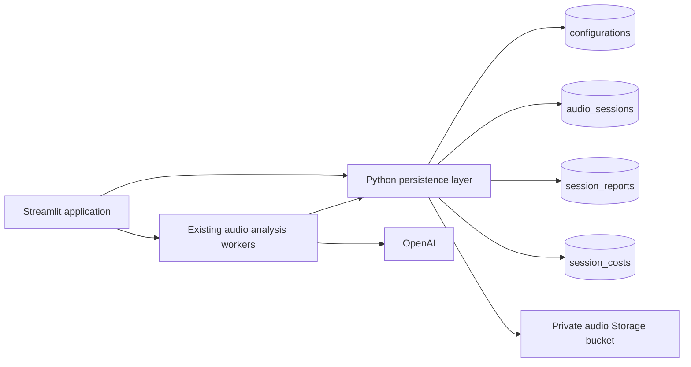
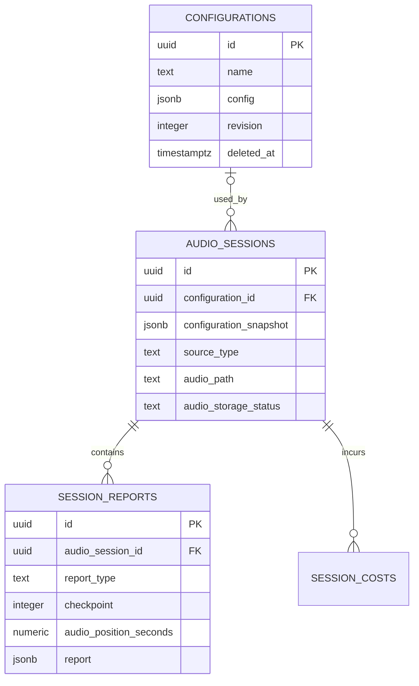

# CatchUpAI Supabase plan: configurations, reports and whole audio

Updated October 14, 2026. The requested scope now includes four application tables and one private Storage bucket: configurations, audio sessions, reports and cost events. Application integration and SQL migrations are prepared. Apply `supabase/migrations/202610140001_audio_persistence.sql`, then `supabase/migrations/202610140002_session_costs.sql` in Supabase SQL Editor. Run `python scripts/supabase_setup.py --import-configurations` to verify setup and import local configurations. Remote verification is pending migration execution.

## 1. Required behavior

1. Save, list, update, load and soft-delete configurations in Supabase.
2. Create one audio session for every live recording or uploaded recording.
3. Save each accepted intermediate report and the accepted final report against that session.
4. Store one complete audio file for the session in Supabase Storage.
5. Load a saved session with its original configuration, report history and audio.

Scope includes the existing conversation configuration and custom report definition together. API usage and cost events are also stored per audio session in `session_costs`, alongside the existing local logs. Document-import, participant, transcript and analysis-run tables are not required.

## 2. Architecture and relationships





- One saved configuration can be used by many audio sessions.
- Each audio session references zero or one saved configuration. The reference is nullable because the existing app can analyze an unsaved editor configuration.
- Every audio session has an immutable configuration snapshot, including sessions without a saved configuration.
- One audio session has many intermediate reports and at most one accepted final report for this initial workflow.
- Each report belongs to exactly one audio session.
- Each successfully archived audio session points to exactly one whole audio file. Storage is a separate service, not a fourth application table.

Example: configuration `Sales call` is used for session A and session B. Session A has reports at 60, 120 and 180 seconds, a final report at 205 seconds, and one `audio.wav` file containing the entire 205 seconds. Session B has its own report history and audio file.

## 3. Table: configurations

Replaces `configuration_templates/*.json` while preserving the existing configuration shape.

| Column | Type | Purpose |
| --- | --- | --- |
| `id` | UUID primary key | Configuration identity |
| `name` | text, not null | Display name |
| `normalized_name` | text, unique, not null | Enforce unique names with current trimmed/casefold semantics |
| `config` | JSONB, not null | Complete conversation configuration and custom report definition |
| `schema_version` | integer, default 1 | Version of the stored configuration format |
| `revision` | integer, default 1 | Detect conflicting edits |
| `created_at` | timestamptz | Creation time |
| `updated_at` | timestamptz | Most recent edit |
| `deleted_at` | timestamptz, nullable, default NULL | Soft-deletion time; NULL means active |

The `config` JSON contains the current fields: purpose, focus areas, speaker roles, topics and ordered coverage criteria, optional CRM content, custom report sections, field options/ranges, required/final-only settings, and analysis interval.

Continue using `validate_config()` before writes and after reads. Normalize names through a controlled write path; PostgreSQL `lower()` does not reproduce Python `casefold()` for all Unicode names. Saving changes should match the loaded revision and increment it, preventing silent overwrites.

Deleting a configuration updates only `deleted_at` to the current UTC time. Do not delete its row or change its name, config, revision or existing timestamps. Any automatic `updated_at` trigger must leave deletion-only updates unchanged. Repeated deletion requests preserve the original deletion time.

Configuration lists, picker options, normal load/update operations and new-session selection use `WHERE deleted_at IS NULL`. Reject stale selections that reference a deleted configuration. Existing audio sessions retain their foreign-key links and snapshots, and remain readable. For now, keep the existing unique-name constraint across active and deleted rows, so deleted names remain reserved.

## 4. Table: audio_sessions

One row per live recording or audio upload. Use the name `audio_sessions` to distinguish durable application records from temporary Streamlit or OpenAI sessions.

| Column | Type | Purpose |
| --- | --- | --- |
| `id` | UUID primary key | Durable audio session identity |
| `configuration_id` | UUID nullable foreign key | Configuration used, if saved |
| `configuration_snapshot` | JSONB, not null | Exact configuration used when processing began |
| `configuration_revision` | integer, nullable | Revision of the saved configuration at start |
| `title` | text | Human-readable session name |
| `source_type` | text | `live` or `upload` |
| `client_session_id` | text, nullable, unique | Browser recording identity for start-event deduplication |
| `status` | text | `recording`, `processing`, `completed`, `completed_with_errors`, `failed`, `cancelled`, `interrupted` |
| `audio_storage_status` | text | `pending`, `uploading`, `stored`, `failed` |
| `audio_bucket` | text | Private bucket name |
| `audio_path` | text, nullable | Whole-file object path; set after upload acknowledgement |
| `original_filename` | text, nullable | Original uploaded name, or generated live filename |
| `audio_mime_type` | text, nullable | WAV, MP3, FLAC or OGG MIME type |
| `audio_size_bytes` | bigint, nullable | Stored file size |
| `duration_seconds` | numeric, nullable | Whole recording duration |
| `started_at` | timestamptz | Processing/recording start |
| `ended_at` | timestamptz, nullable | Recording/processing end |
| `error_summary` | text, nullable | Short explanation of incomplete processing or saving |
| `created_at` | timestamptz | Row creation |
| `updated_at` | timestamptz | Latest lifecycle/storage change |

Foreign key: `configuration_id -> configurations.id ON DELETE RESTRICT`. Normal deletion is a soft update, so the link remains intact. Do not grant the application hard-delete access to configuration rows.

The snapshot preserves the meaning of old reports if the configuration is renamed, changed or deleted. Historical reports must render using this snapshot, not the latest configuration row. Keep its arrays and IDs unchanged because coverage criteria currently use positional keys.

Only mark a session `completed` when both its final report and complete audio file have been persisted. A final report can be saved while audio archival remains pending or failed; show those states separately. On restart, mark abandoned active sessions interrupted rather than presenting them as complete.

## 5. Table: session_reports

One row per accepted report snapshot. Intermediate snapshots are retained rather than overwritten by subsequent reports.

| Column | Type | Purpose |
| --- | --- | --- |
| `id` | UUID primary key | Report identity; retain it across persistence retries |
| `audio_session_id` | UUID, not null, foreign key | Parent recording/upload |
| `report_type` | text, not null | `intermediate` or `final` |
| `checkpoint` | integer, not null | Existing report checkpoint number |
| `audio_position_seconds` | numeric, not null | Actual audio position analyzed, from current result `timestamp` |
| `report` | JSONB, not null | Validated payload from current result `report` |
| `result_metadata` | JSONB | Additional existing result metadata, such as interval bounds |
| `schema_version` | integer, default 1 | Stored report envelope version |
| `generated_at` | timestamptz, not null | Generation time reported by the application |
| `created_at` | timestamptz | Database persistence time |

Foreign key: `audio_session_id -> audio_sessions.id ON DELETE CASCADE`.

Use checks for the report type and nonnegative checkpoint/audio position. Add unique `(audio_session_id, report_type, checkpoint)` to make retry/reconnect persistence idempotent for the current workflow. Add a partial unique index on `audio_session_id WHERE report_type = 'final'` to enforce one final report. Intermediate and final reports can have the same checkpoint number because type distinguishes them.

Deduplication represents the same logical checkpoint, not the changing `analysis_N` request counter. Reuse the accepted snapshot's ID on database retries; conflicting content must be investigated rather than silently overwritten. A future deliberate reanalysis feature would need a new session or an explicit generation/revision model.

Save only outputs accepted by the existing report validation/repair pipeline. Preserve all dynamic section values, topic coverage and CRM comparisons inside JSONB. Upload analysis currently generates a final report only; it does not need artificial intermediate rows.

Display a final report when one exists; otherwise select the intermediate report with the greatest audio position/checkpoint. Do not select by insertion time alone: delayed writes can arrive out of order. If final generation fails, the last valid intermediate report remains available and clearly labeled.

### 5.1 Table: session_costs

Foreign key: `audio_session_id -> audio_sessions.id ON DELETE CASCADE`. One audio
session has many cost events; costs are not linked only to successful reports because
failed requests and rejected repairs can also incur charges.

| Columns | Purpose |
| --- | --- |
| `id`, `audio_session_id` | Immutable event ID and parent audio session |
| `event_type` | `api_response` or `usage_gap` |
| `api`, `response_id`, `model`, `purpose`, `response_status` | Provider response identity and processing context |
| `input_tokens`, `output_tokens`, `total_tokens` | Queryable counts; NULL when unavailable |
| `usage`, `analysis`, `breakdown` | Complete raw usage, checkpoint/final/repair metadata, and disjoint billable categories |
| `cost_usd` | Estimated response cost as numeric(20,10); NULL means unknown |
| `rates_usd_per_million`, `pricing_date`, `pricing_source` | Original rates used, so historical costs do not change with future prices |
| `reason` | Why usage is missing, for gap events |
| `logged_at`, `created_at` | Event occurrence and database persistence times |

Unique `(api, response_id)` prevents duplicate charges during retries/replayed writes.
Gap events use deterministic event IDs to avoid duplication on outbox replay. Never
sum cumulative usage log summaries as charges. Totals sum known response costs and
separately count unknown responses/gaps; reasoning is already part of output usage.

The existing tracker writes events to the durable local outbox; only the background
writer performs database requests. It captures live, uploaded-recording and repair
responses even if report generation fails, and can retain late repair charges after
session completion. Saved Sessions displays the persisted cost breakdown and CSV.

Apply the separate additive migration `202610140002_session_costs.sql` after the original
schema migration. Existing audio/report rows are retained. Old cost logs are not
automatically backfilled, and document extraction without an audio session stays local.

## 6. Whole audio storage

Create one private bucket named `session-audio`.

```text
session-audio/
  <audio_session_id>/
    audio.wav       # complete live recording
```

For uploaded recordings, retain the complete original file using a safe generated filename and its actual extension, for example `<audio_session_id>/audio.mp3`. Keep the original user filename in the database.

Each session has one audio object. PostgreSQL stores its path and metadata, not binary audio or base64 data. Generate temporary signed URLs for playback/download instead of storing expiring URLs. Supabase supports private-bucket authenticated downloads and signed URLs: [Storage bucket documentation](https://supabase.com/docs/guides/storage/buckets/fundamentals).

### Live recording flow

1. Create `audio_sessions` and freeze its configuration before starting analysis.
2. Continue the existing chunk-based capture/transport and local recovery mechanism during recording. No chunk objects or chunk rows are written to Supabase.
3. Persist each accepted intermediate report through a background writer independently of Streamlit reruns.
4. On Stop, wait for the last browser audio sequence to be received and acknowledged.
5. Assemble all PCM into one valid WAV file and upload it once. The server already has a complete temporary PCM stream; add a WAV container with the correct 24 kHz, mono, 16-bit metadata. Archive before `BrowserAudioSession._run()` closes its temporary file.
6. Persist the accepted final report. Final analysis and audio archival can finish independently.
7. Mark the session completed after both database report persistence and whole-file storage succeed.

Do not wait for final-report success before archiving audio: even failed analysis should leave the full recording available. Keep the browser copy/temp file until storage succeeds or a clear retry/recovery path exists. Whole-file-only archival means an interrupted recording is not already backed up in Supabase; preserve existing local recovery behavior.

### Uploaded recording flow

1. Validate the file and create an audio session with its configuration snapshot.
2. Store the complete original recording in the private bucket and record its metadata.
3. Analyze it through the existing uploaded-recording pipeline.
4. Save its accepted final report and update session status.

Retain the audio if analysis fails. If storage fails, retry archival and do not claim the session has been fully saved. Upload retries should target the same session object and verify an existing matching file instead of creating duplicate files.

## 7. Application changes

| File | Required change |
| --- | --- |
| `catchupai/config.py` | Add Supabase URL and server-side key settings |
| Dependencies | Use the REST/Storage APIs through Python's standard library; no extra SDK dependency |
| `catchupai/templates.py` | Replace filesystem CRUD with configuration repository operations; delete sets only `deleted_at`, and normal list/load/update operations filter active rows |
| `app.py` | Create durable sessions, pass session IDs to workers, and load saved sessions/report history/audio |
| `catchupai/browser_audio.py` | Persist accepted reports and archive the complete PCM stream as one WAV before closing it |
| `catchupai/session.py` | Pass persistence context into upload/live workers; archive server-microphone audio too if that optional CLI must be supported |
| `catchupai/recording.py` | Link upload analysis results to the durable session |
| `catchupai/report_export.py` | Reuse existing export rendering with saved snapshots |

Introduce small configuration/session/report repository interfaces and a background persistence writer. Do not perform network writes inside capture/heartbeat handling or rely on `app.py` draining UI events to save reports. Retry writes with stable IDs. A memory queue isolates capture latency but does not survive process crashes; use a protected retry spool if that durability is needed.

Temporary chunks remain an implementation detail of capture. The persisted audio is always the one final whole file.

## 8. Access, indexes and deletion

This plan adds no profile/team/billing tables. For a single-user deployment, keep database and Storage operations behind the restricted Python application and do not grant anonymous clients access. Keep server secrets out of browser code.

If multiple users will use the app, add `owner_id references auth.users(id)` to configurations and audio sessions, scope names/client IDs to the owner, and enable owner-based RLS. Reports inherit ownership through their session. Reject cross-owner configuration references, and use owner-prefixed Storage paths. Supabase supplies `auth.users`; no custom users table is required. Secret/service-role keys bypass RLS, so server operations using them must enforce authorization explicitly: [Supabase security documentation](https://supabase.com/docs/guides/database/secure-data).

Minimum indexes:

- Unique normalized configuration name (per owner if multiuser).
- `audio_sessions(configuration_id)` and `audio_sessions(created_at DESC)`.
- Unique non-null client session identity (per owner if multiuser).
- Report deduplication and final-only unique indexes described above.
- `session_reports(audio_session_id, audio_position_seconds)` for history.

Store wall-clock timestamps in UTC and format locally in the UI. Audio position remains elapsed seconds.

Deleting a configuration sets only `configurations.deleted_at`; its row, session references and snapshots remain intact. Exclude deleted configurations from normal selection and editing, and provide no application hard-delete operation. Session deletion is outside the current UI scope. If added later, coordinate report deletion with whole-audio object removal: database cascades do not delete Storage objects.

## 9. Implementation order

1. Create the three tables, constraints and private bucket, then add the persistence layer.
2. Migrate existing configuration JSON files and switch save/load/update/soft-delete to Supabase. Preserve IDs through UUID conversion or a migration mapping and make imports repeatable.
3. Add audio session creation and intermediate/final report persistence.
4. Add whole live-WAV archival and complete uploaded-file storage.
5. Add saved-session loading with report history and audio playback/download.
6. Verify duplicate callbacks, configuration edits/soft-deletion, late report writes, storage failures, and failed final generation. For configuration deletion, verify only `deleted_at` changes, repeated requests preserve its value, active queries exclude the row, stale selections are rejected, and existing session links remain intact. Run existing report/capture tests during implementation.

The resulting model is: configuration -> audio session -> intermediate/final reports, with one complete Storage audio file attached to each saved session.
